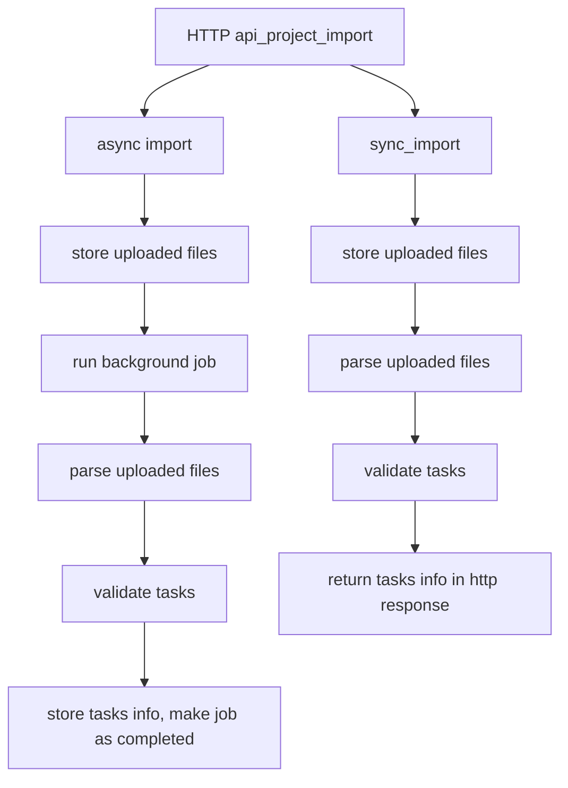

# Data import
Data import app contains models and apis for serving Import pages in DM or during project creation


### Async import



### Document upload preprocessing

Document annotation projects can upload source files through:

`POST /api/projects/<project_id>/upload-files`

The default preprocessor accepts:

- `.txt`
- `.md`
- `.markdown`

PDF and DOCX require a configured converter and explicit extension configuration, as shown below.

The flow is:

1. Store the uploaded file as a `data_import.FileUpload`.
2. Create a `projects.ProjectImport` batch with `import_type=document_upload`.
3. Enqueue background preprocessing for every valid file in the batch.
4. Call the configured document preprocessor from the worker.
5. Convert the preprocessor output into normal Label Studio task payloads.
6. Validate and create tasks through the standard import serializer.
7. Persist per-file preprocessing status, errors, and created task IDs back onto `FileUpload`.
8. Persist a `data_import.DocumentConversionArtifact` for each successful upload so raw markdown and rich converter output can be reused later.

### Raw markdown annotation surface

For document projects that annotate raw markdown directly, use:

```xml
<View>
  <Labels name="pii" toName="md">
    <Label value="PERSON" />
  </Labels>
  <Text name="md" value="$markdown" granularity="word" />
</View>
```

`data.markdown` remains the authoritative annotation source. The upload pipeline removes leading BOMs, normalizes line endings to LF, and applies Unicode NFC normalization before annotation.

The upload endpoint is asynchronous:

- `POST /api/projects/<project_id>/upload-files` returns `202 Accepted`
- the response includes `{"import": <id>, "results": [...]}` for the initial batch state
- poll `GET /api/projects/<project_id>/imports/<import_id>/` for per-file progress and final results

#### Local async runtime

Document uploads now require Redis and an RQ worker in addition to the main app container.

Relevant settings:

```bash
export REDIS_ENABLED=true
export REDIS_HOST=redis
export REDIS_PORT=6379
export REDIS_DB=0
export LABEL_STUDIO_DOCUMENT_UPLOAD_JOB_TIMEOUT_SECONDS=3600
```

#### Configuration

Set a custom preprocessor import path with:

```bash
export LABEL_STUDIO_FILE_PREPROCESSOR="package.module:function"
```

Optional size and extension controls:

```bash
export LABEL_STUDIO_DOCUMENT_UPLOAD_MAX_FILE_SIZE=10485760
export LABEL_STUDIO_DOCUMENT_UPLOAD_ALLOWED_EXTENSIONS=".txt,.md,.markdown"
```

#### Azure Document Intelligence preprocessor

To use Azure Document Intelligence Layout as the active preprocessor:

```bash
export LABEL_STUDIO_FILE_PREPROCESSOR="data_import.document_preprocessing.azure_document_intelligence_preprocessor"
export LABEL_STUDIO_DOCUMENT_UPLOAD_ALLOWED_EXTENSIONS=".txt,.md,.markdown,.pdf,.docx"
export LABEL_STUDIO_AZURE_DI_ENDPOINT="https://<resource>.cognitiveservices.azure.com/"
export LABEL_STUDIO_AZURE_DI_KEY="<secret>"
export LABEL_STUDIO_AZURE_DI_API_VERSION="2024-11-30"
export LABEL_STUDIO_AZURE_DI_MODEL_ID="prebuilt-layout"
export LABEL_STUDIO_AZURE_DI_OUTPUT_CONTENT_FORMAT="markdown"
export LABEL_STUDIO_AZURE_DI_POLL_INTERVAL_SECONDS=2
export LABEL_STUDIO_AZURE_DI_SYNC_TIMEOUT_SECONDS=180
```

Behavior:

- `.txt`, `.md`, `.markdown`: local passthrough into `data.markdown`
- `.pdf`, `.docx`: submit to Azure DI Layout, poll until completion, and create tasks from markdown
- full Azure DI JSON is persisted as a compressed artifact file for later layout-aware rendering or training use
- task payloads stay markdown-first for annotation in this phase

#### External document service (Docling)

Configure the environment below before starting the optional converter with `docker compose --profile docling up --build`:

```bash
export LABEL_STUDIO_FILE_PREPROCESSOR="data_import.document_preprocessing.external_document_service_preprocessor"
export LABEL_STUDIO_DOCUMENT_CONVERTER_URL="http://docling-converter:8090/convert"
export LABEL_STUDIO_DOCUMENT_UPLOAD_ALLOWED_EXTENSIONS=".txt,.md,.markdown,.pdf,.docx"
```

#### Default preprocessor behavior

- `.txt`, `.md`, `.markdown`: read as UTF-8 and store content in `data.markdown`
- Other extensions are rejected by default. Enable PDF/DOCX only when selecting the Azure or external service preprocessor.

#### Persisted artifacts

Every successful document upload creates one `DocumentConversionArtifact` linked to the source `FileUpload`.

Artifacts can contain:

- raw markdown returned by the preprocessor
- normalized annotation markdown matching the task annotation text
- compressed raw converter output, for example Azure DI JSON
- lightweight provider metadata such as model id, API version, and operation id

#### Example curl

```bash
curl -H "Authorization: Token <token>" \
  -X POST "http://localhost:8080/api/projects/123/upload-files" \
  -F 'files=@/path/to/example.md' \
  -F 'files=@/path/to/scan.pdf' \
  -F 'metadata={"source":"internal-docs"}'
```

#### Example custom preprocessor

```python
def preprocess_document(context):
    with open(context["uploaded_file_path"], encoding="utf-8") as stream:
        body = stream.read()

    return [
        {
            "data": {
                "doc_id": "stable-id",
                "source_filename": context["original_filename"],
                "source_mime_type": context["mime_type"],
                "markdown": body,
            },
            "meta": {
                "preprocessor": "custom.text",
                "source_upload_id": str(context["file_upload_id"]),
            },
        }
    ]
```

#### Later integration points

- Replace the default preprocessor with a Docling adapter in `LABEL_STUDIO_FILE_PREPROCESSOR`.
- Extend the Azure artifact consumer to render layout-rich OCR output in the UI while keeping markdown and raw JSON available for training/export.
- Add AAD-based auth for Azure DI if API-key auth is no longer sufficient.
- Extend the returned task payloads if later pipelines need layout blocks, page metadata, or chunked document tasks.
